# BeyondTrust Password Safe: PAM & Access Governance (Practice Project)

> **Project type:** Design and documentation project in a *simulated* environment ("Contoso Lab").
> **Author:** Sanchit Gangwar, Cloud Security Analyst
> **Product focus:** BeyondTrust Password Safe (privileged password management and session management)

## 1. Objective
Design an end-to-end Privileged Access Management (PAM) model for a small hybrid environment (on-prem Windows/Linux plus Azure). The model covers how privileged accounts are **discovered, onboarded, vaulted, rotated, requested, approved, monitored and audited**, following **least privilege** and **time-bound access**.

## 2. Scope
| In scope | Out of scope |
|---|---|
| Account/asset discovery and onboarding design | Production deployment |
| Smart Rules / Smart Groups design | Vendor-specific licensing/sizing |
| Access policy matrix (role × asset tier × controls) | Endpoint Privilege Management (EPM) |
| Credential vaulting and rotation design | Full SIEM integration build |
| Approval, exception and break-glass workflow | |
| Session monitoring and audit evidence | |
| SOP, checklist, troubleshooting runbook | |

## 3. Simulated Environment
| Tier | Asset type | Example | Account types |
|---|---|---|---|
| Tier 0 | Domain Controller | `DC01` | Domain Admin, service/functional accounts |
| Tier 1 | Windows member servers | `APP01`, `SQL01` | Local Administrator, service accounts, SQL `sa` |
| Tier 1 | Linux servers | `LNX01`, `LNX02` | `root`, sudo-capable admin users |
| Tier 2 | Network devices | `FW01`, `SW01` | Local admin/enable |
| Cloud | Azure VMs / Entra ID | `AZ-VM01` | Local admin, break-glass Entra account |

## 4. High-Level Workflow

```mermaid
flowchart LR
    A[Discovery scan<br/>AD / network / cloud] --> B[Triage & classify<br/>owner, tier, criticality]
    B --> C[Onboard as Managed System<br/>+ Managed Account]
    C --> D[Smart Rules assign<br/>accounts to Smart Groups]
    D --> E[Vault credential<br/>+ set rotation policy]
    E --> F{User requests access}
    F --> G[Access Policy check<br/>role, time, asset tier]
    G -->|Low risk| H[Auto-approve<br/>time-bound]
    G -->|High risk| I[Approver reviews<br/>justification + ticket]
    I -->|Approved| H
    I -->|Denied| J[Request closed + logged]
    H --> K[Credential released<br/>session proxied & recorded]
    K --> L[Check-in / timeout]
    L --> M[Password auto-rotated]
    M --> N[Audit log + evidence<br/>reviewed periodically]
```

## 5. Deliverables
| # | Document | Purpose |
|---|---|---|
| 1 | [Architecture & Design Principles](docs/01-architecture-and-principles.md) | Components, roles, design decisions |
| 2 | [Privileged Account Lifecycle](docs/02-account-lifecycle.md) | Discovery → onboarding → retirement |
| 3 | [Smart Rules & Smart Groups](docs/03-smart-rules-and-groups.md) | Automated grouping and ownership mapping |
| 4 | [Least-Privilege Access Policy Matrix](docs/04-access-policy-matrix.md) | Who can access what, how, and for how long |
| 5 | [Approval, Exception & Break-Glass](docs/05-approval-exception-breakglass.md) | Workflow for non-standard access |
| 6 | [Account Onboarding Checklist](docs/06-onboarding-checklist.md) | Repeatable onboarding steps |
| 7 | [Operational SOP](docs/07-operational-sop.md) | Day-to-day procedures |
| 8 | [Troubleshooting Notes](docs/08-troubleshooting.md) | Access, rotation and session-audit issues |
| 9 | [Audit Evidence & Reporting](docs/09-audit-evidence.md) | What to collect and review |
| 10 | [Control Mapping](docs/10-control-mapping.md) | Mapping to ISO 27001 / NIST / CIS |

## 6. Key Outcomes
- No shared or unmanaged privileged credentials in the target design.
- Every privileged access is **requested, justified, time-bound, and recorded**.
- Credentials are **rotated after every use** (Tier 0/1) or on a defined schedule.
- Clear ownership for every managed account.
- Audit-ready evidence list for each control.

## 7. Skills Demonstrated
PAM lifecycle design, least privilege, RBAC, credential vaulting/rotation, Smart Rules/Groups, approval workflows, session auditing, operational documentation, control mapping.

## 8. Disclaimer
This is a practice/design project using fictional hosts and data. No real credentials, IPs or customer information are included.
