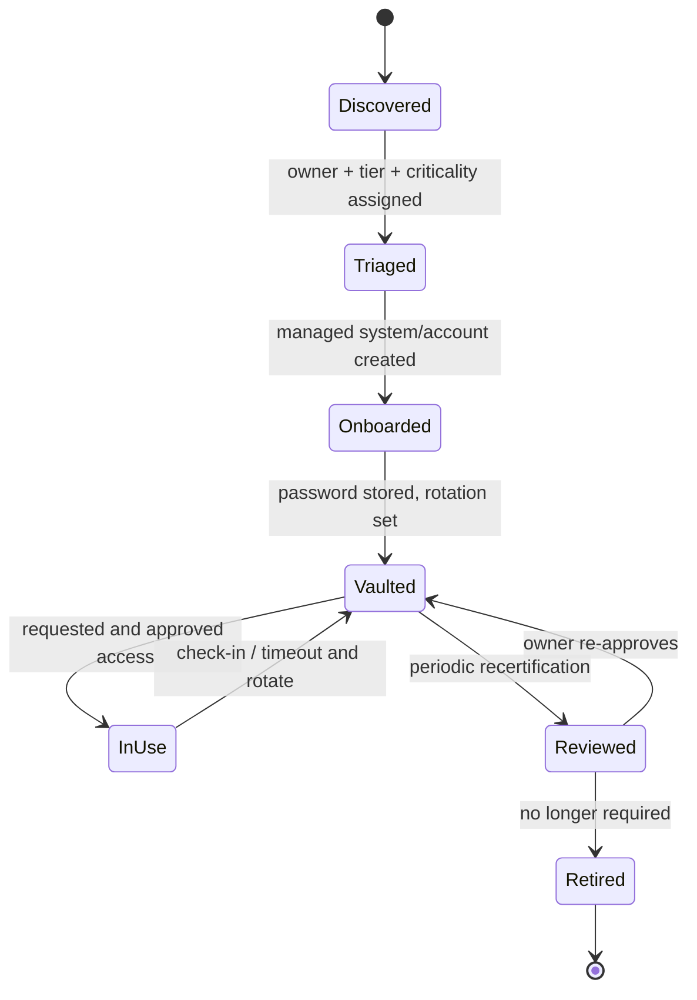

# 02. Privileged Account Lifecycle

## Stage Detail
| Stage | Activities | Output / Evidence |
|---|---|---|
| **Discovery** | Scan AD, subnets, cloud inventory for privileged/local/service accounts | Discovery report |
| **Triage** | Classify tier (0/1/2), identify owner, record business justification, check for shared/stale accounts | Triage register |
| **Onboarding** | Create Managed System; add Managed Account; assign Functional Account; set platform | Onboarding checklist (signed) |
| **Vaulting & Rotation** | Store credential; set rotation schedule + change-on-release; test rotation | Rotation test result |
| **Access** | Request via access policy; approval; session brokered and recorded | Request log, session recording |
| **Recertification** | Owner reviews quarterly (Tier 0/1) or semi-annually (Tier 2) | Recertification record |
| **Retirement** | Remove from vault, disable/delete target account, archive logs | Decommission record |

## Account Categories
| Category | Examples | Handling |
|---|---|---|
| Built-in local admin | Windows `Administrator`, Linux `root` | Vault + rotate after each use |
| Domain admin | `DA-<user>` | Vault, strong approval, session recording |
| Service/application | `svc_sql`, `svc_backup` | Vault + scheduled rotation + dependency check before rotation |
| Database privileged | SQL `sa` | Vault + approval + recording |
| Network device | Firewall/switch admin | Vault + rotate + change-window approval |
| Cloud/break-glass | Entra emergency account | Sealed process (see doc 05) |
