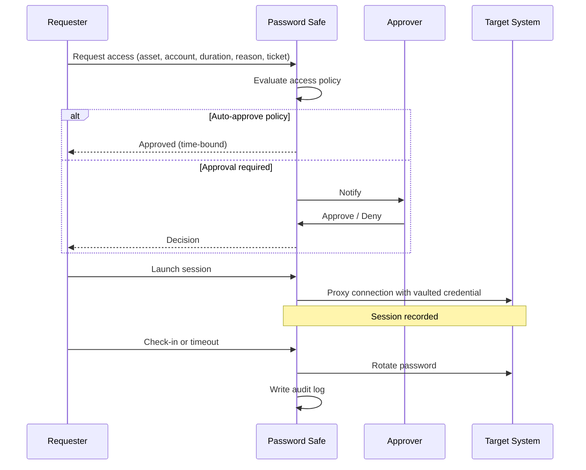

# 05. Approval, Exception & Break-Glass Workflow

## Standard Request

## Approver Checklist
1. Is the ticket/change valid and current?
2. Does the business justification match the requested asset?
3. Is the requested duration minimal?
4. Is the requester in the correct role group?
5. Any conflicting change/incident?

## Break-Glass Procedure
**When:** Password Safe unavailable, or critical incident requiring immediate Tier 0 access.
1. Declare incident; get approval from Security Manager and Head of Infrastructure.
2. Retrieve sealed emergency credential (two-person control).
3. Log start time, reason, people involved.
4. Perform only the actions needed.
5. Rotate the emergency credential immediately afterward and re-seal.
6. Post-incident review within 2 working days; attach logs/recordings.
7. Alert is generated on any use of the break-glass account.
